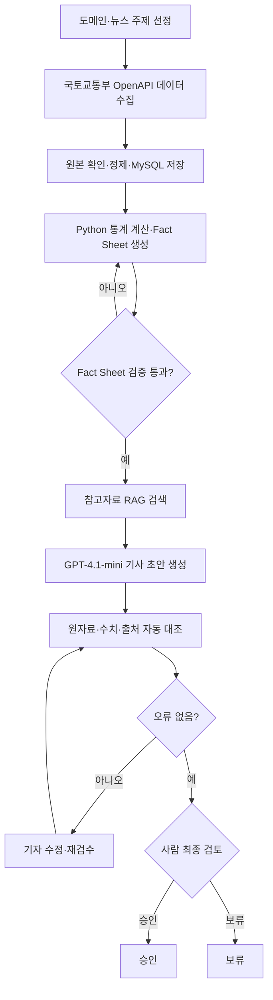
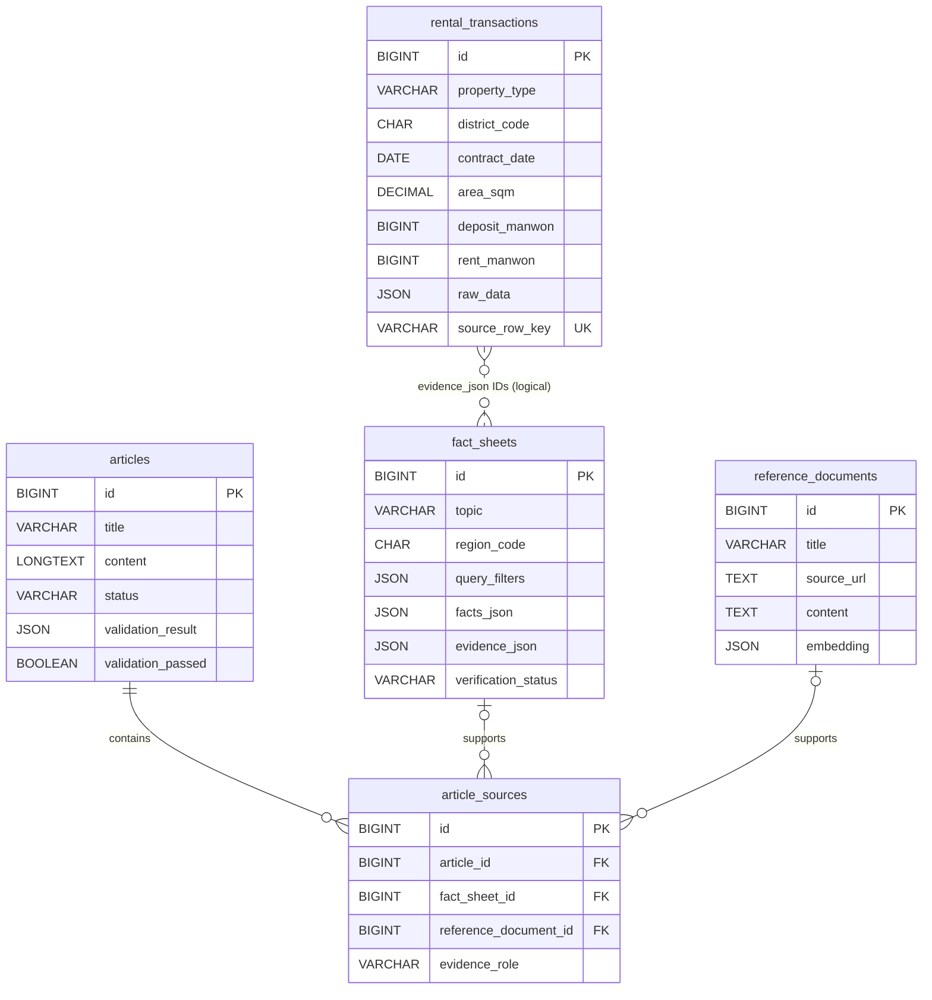

# RentWatch Seoul

> **서울 전월세 실거래 데이터 기반 RAG·AI 기사 생성 및 검수 미니 서비스**  
> 대상 독자: 한국의 부동산부 취재기자 · 단계: **DB 스키마·뼈대 작성** · 설계 기준: 2026-10-20

## 목차
1. [프로젝트 소개](#1-프로젝트-소개)
2. [기능정의서](#2-기능정의서)
3. [화면구성도](#3-화면구성도)
4. [DB 설계](#4-db-설계)
5. [데이터 수집 방법](#5-데이터-수집-방법)
6. [개발 환경](#6-개발-환경)
7. [실행 방법](#7-실행-방법)
8. [테스트 항목](#8-테스트-항목)

## 1. 프로젝트 소개

**RentWatch Seoul**은 국토교통부의 전월세 실거래가를 수집·저장하고, 계산된 **Fact Sheet**와 출처가 명확한 **RAG 검색 근거**를 결합해 AI 기사 초안을 작성하는 기자용 웹 앱이다. AI 결과를 원자료와 대조하고, **기자가 최종 승인하거나 보류**한다. 자동 검수에 실패한 기사의 승인은 서버에서도 차단한다.

- **도메인·뉴스 주제:** 서울 주택 전월세 거래의 지역별·시기별 변화
- **독자:** 한국 부동산부 취재기자
- **v0.1 초기 범위:** 서울 **관악구(11620)**, **오피스텔**, **2025년 10월~2026년 9월**(완료된 12개 계약월), 전세·월세 분리 분석
- **향후 확장:** 서울 25개 자치구 및 아파트·연립다세대·단독다가구
- **기사 예시:** “관악구 오피스텔 월세 거래금액, 최근 1년간 어떻게 달라졌나?” (실제 수치는 수집 후 산출)
- **분석상 한계:** 실거래 자료는 특정 시점의 신고 자료이며 지연 신고·정정이 발생할 수 있다. 거래금액 변화가 임차인의 소득 대비 부담이나 청년 전체의 주거비 변화를 직접 뜻하지는 않는다. 보증금·면적 등 조건이 다른 월세를 무조건 합산해 대표값으로 사용하지 않는다.

**화면 이미지 자리 (구현 후 교체):**

> [스크린샷 자리] 데이터 분석 / Fact Sheet / AI 기사 작성 / 검수·승인  
> 아직 구현되지 않았으므로 실제 화면 이미지는 첨부하지 않음.

**전체 작업 흐름**



**책임 분리:** 수치·증감률은 **Python**이 계산한다. 국토교통부 원자료/Fact Sheet가 수치의 기준이며, **RAG**는 정책·법령 등 맥락을 보완한다. **LLM**은 글을 작성하며 사실을 임의로 채우지 않는다. 사람의 최종 승인 없이 자동 발행하지 않는다.

## 2. 기능정의서

| ID | 기능명 | 설명 | 입력 → 출력 |
|---|---|---|---|
| F01 | 뉴스 주제 선정 | 지역·기간·주택 유형·질문 지정(v0.1은 관악구 오피스텔 고정) | 조건·질문 → 분석 설정 |
| F02 | 데이터 수집 | 국토교통부 오피스텔 전월세 API 호출 | 인증키·지역코드·계약월 → XML |
| F03 | 데이터 정제·저장 | 금액·날짜·면적 변환, 원본 보관, 중복 방지 | XML → 거래 레코드 |
| F04 | CRUD·오류 처리 | 거래 데이터 조회·등록·정정·삭제 테스트; 승인 근거 삭제 방지 | 요청 → 결과/오류 |
| F05 | 통계 분석 | 전세·월세 분리, 건수·중위값·변화 계산 | 거래·조건 → 통계 |
| F06 | Fact Sheet 검증 | 표본 수·기간·원본 ID·계산값·한계 점검 | 통계·원본 → Fact Sheet·PASS/FAIL |
| F07 | RAG 검색 | 등록된 공공기관 참고문서에서 관련 구간 검색 | 질문 → 구간·출처 |
| F08 | LLM 기사 생성 | Fact Sheet 및 RAG 근거로 초안 생성 | 근거·프롬프트 → 제목·본문 |
| F09 | 자동 검수 | 수치·증감률·출처·근거 없는 인과 단정 점검 | 기사·근거 → 오류 목록·검수 결과 |
| F10 | 기사 수정 | 기자가 초안 수정, 종전 검수 통과 무효화 | 수정 본문 → 검토대기·재검수 필요 |
| F11 | 승인·보류 | 자동 검수 통과 + 사람 판단으로 상태 변경 | 검수·결정 → 검토대기/승인/보류 |
| F12 | 기사 이력 | 사용된 Fact Sheet·RAG 문서·검수 결과 열람 | 기사 ID → 기사·근거·상태 |

**승인 차단 규칙:** 기사 상태는 `검토대기`/`승인`/`보류` 셋뿐이다. `validation_passed=true`, 연결 Fact Sheet의 `PASSED`, 현재 본문에 대한 검수 결과, 실제 사람의 승인 요청을 모두 충족해야 승인 가능하다. 버튼 비활성화만으로 끝내지 않고 FastAPI 승인 처리 단계에서 검사한다. 자동 검수 통과가 기사 전체의 진실성을 보증하지는 않는다.

**v0.1 비범위:** 로그인·권한 체계, 자동 발행, 이미지 생성, 무제한 뉴스 크롤링, 전국 데이터 통합.

## 3. 화면구성도

| 화면 ID | 화면 | 주요 구성 요소 | 주요 동작 |
|---|---|---|---|
| S01 | 데이터 분석 | 관악구·오피스텔 표시, 기간·전월세 조건, 수집 버튼, 거래 목록, 월별 통계 | 수집·조회·분석 |
| S02 | Fact Sheet | 취재 질문, 계산값·단위·표본 수, 비교 기간, 원본 거래 ID, 출처, 검증 상태 | 생성·원자료 대조 |
| S03 | AI 기사 작성 | Fact Sheet 패널, 검색된 RAG 근거·URL, 생성 버튼, 제목·본문 편집기 | 근거 검색·초안 생성·수정 |
| S04 | 검수·승인 | 기사·근거 비교, 오류표, 검수표, 승인·보류 버튼, 기사 이력 | 재검수·승인·보류 |

**화면 이동:** `S01 데이터 분석 → S02 Fact Sheet(검증 통과) → S03 AI 기사 작성 → S04 검수·승인`. 오류 시 `S04 → S03(수정) → S04(재검수)`.

- S01: 월세·전세와 면적·보증금 조건을 구분한다.
- S02: 계산 불가·자료 부족·신고 지연을 숨기지 않는다.
- S03: 근거가 없는 수치·맥락을 LLM이 만들어내지 못하게 입력을 제한한다.
- S04: 본문 수정 시 재검수를 강제하고, 실패 상태에선 승인 차단한다.

## 4. DB 설계

**MySQL 8.4 LTS, 총 5개 테이블.** PK = 행의 고유 ID, FK = 다른 테이블을 가리키는 참조. 자료형과 제약은 구현 전 초안이며 실제 오피스텔 API 필드 확인 후 조정한다.

### 4.1 `rental_transactions` — 개별 전월세 거래

| 컬럼 | 타입 | 키/제약 | 설명 |
|---|---|---|---|
| id | BIGINT | PK, AUTO_INCREMENT | 내부 거래 ID |
| property_type | VARCHAR(30) | NOT NULL | 초기 `OFFICETEL` |
| district_code | CHAR(5) | NOT NULL | 초기 `11620` |
| district_name | VARCHAR(50) | NOT NULL | 관악구 |
| building_name | VARCHAR(200) | NULL | 건물명(제공 시) |
| contract_date | DATE | NOT NULL | 계약일 |
| area_sqm | DECIMAL(10,2) | NOT NULL, > 0 | 면적 |
| deposit_manwon | BIGINT | NOT NULL, >= 0 | 보증금(만원) |
| rent_manwon | BIGINT | NOT NULL, >= 0 | 월세(만원) |
| floor_no | SMALLINT | NULL | 층수 |
| raw_data | JSON | NOT NULL | 원본 항목 |
| source_row_key | VARCHAR(128) | UNIQUE, NOT NULL | 재수집 중복 방지용 식별 키 |
| collected_at | DATETIME | NOT NULL | 수집 시각 |

**주의:** 동일한 계약일·금액·면적이 실제로 별개의 거래일 수 있다. API에서 고유 거래 ID가 확인되지 않으면 안전한 식별·재수집 전략을 샘플로 결정하기 전까지 자동 중복 제거를 확정하지 않는다. 과거 수집 결과와 기사 근거를 훼손하는 임의 삭제는 피한다.

### 4.2 `reference_documents` — RAG 참고문서 구간

| 컬럼 | 타입 | 키/제약 | 설명 |
|---|---|---|---|
| id | BIGINT | PK, AUTO_INCREMENT | 구간 ID |
| title | VARCHAR(300) | NOT NULL | 제목 |
| source_org | VARCHAR(100) | NOT NULL | 발행기관 |
| source_url | TEXT | NOT NULL | 원문 링크 |
| published_at | DATE | NULL | 발행일 |
| chunk_index | INT | NOT NULL, >= 0 | 문서 내 구간 |
| content | TEXT | NOT NULL | 검색할 본문 |
| embedding | JSON | NULL | 임베딩 벡터 |
| collected_at | DATETIME | NOT NULL | 등록 시각 |

### 4.3 `fact_sheets` — 계산 결과와 검증

| 컬럼 | 타입 | 키/제약 | 설명 |
|---|---|---|---|
| id | BIGINT | PK, AUTO_INCREMENT | Fact Sheet ID |
| topic | VARCHAR(300) | NOT NULL | 취재 질문 |
| region_code | CHAR(5) | NOT NULL | 분석 지역 |
| property_type | VARCHAR(30) | NOT NULL | 주택 유형 |
| period_start | DATE | NOT NULL | 분석 시작 |
| period_end | DATE | NOT NULL, >= period_start | 분석 끝 |
| query_filters | JSON | NOT NULL | 전월세·면적·보증금 등 |
| facts_json | JSON | NOT NULL | 수치·단위·표본 수·변화 |
| evidence_json | JSON | NOT NULL | 거래 ID, 계산식, 출처, 수집 시점 |
| verification_status | ENUM('PENDING','PASSED','FAILED') | NOT NULL, 기본 PENDING | 기초 검증 상태 |
| created_at | DATETIME | NOT NULL | 생성 시각 |

### 4.4 `articles` — 기사·상태

| 컬럼 | 타입 | 키/제약 | 설명 |
|---|---|---|---|
| id | BIGINT | PK, AUTO_INCREMENT | 기사 ID |
| title | VARCHAR(500) | NOT NULL | 제목 |
| content | LONGTEXT | NOT NULL | 본문 |
| status | ENUM('검토대기','승인','보류') | NOT NULL, 기본 '검토대기' | 기사 상태 |
| generated_model | VARCHAR(100) | NOT NULL | GPT 모델명 |
| prompt_version | VARCHAR(50) | NOT NULL | 프롬프트 버전 |
| validation_result | JSON | NULL | 검수 결과 |
| validation_passed | BOOLEAN | NOT NULL, 기본 FALSE | 현재 본문에 대한 통과 여부 |
| reviewed_by | VARCHAR(100) | NULL | 검토자 |
| reviewed_at | DATETIME | NULL | 검토 시각 |
| created_at | DATETIME | NOT NULL | 생성 시각 |
| updated_at | DATETIME | NOT NULL | 수정 시각 |

### 4.5 `article_sources` — 기사별 사용 근거

| 컬럼 | 타입 | 키/제약 | 설명 |
|---|---|---|---|
| id | BIGINT | PK, AUTO_INCREMENT | 연결 ID |
| article_id | BIGINT | FK → articles.id, NOT NULL | 기사 |
| fact_sheet_id | BIGINT | FK → fact_sheets.id, NULL | 수치 근거 |
| reference_document_id | BIGINT | FK → reference_documents.id, NULL | RAG 맥락 근거 |
| evidence_role | VARCHAR(30) | NOT NULL | STATISTIC 또는 CONTEXT |
| created_at | DATETIME | NOT NULL | 연결 시각 |

`fact_sheet_id`와 `reference_document_id`는 **정확히 하나만 채운다**(CHECK 제약). 기사 1건에 여러 근거를 연결할 수 있다. Fact Sheet는 `evidence_json`에 계산에 쓰인 거래 ID 목록을 보존한다. 원천 거래 ↔ Fact Sheet 관계는 실제 FK가 아닌 **논리적 연결**이므로 생성·검증 시 해당 거래 ID 존재 여부를 확인해야 한다.

### 4.6 ERD



**근거 보존:** 승인 기사에 연결된 Fact Sheet·문서는 임의 삭제하지 않는다. 본문이나 근거가 수정되면 기존 검수 통과 결과를 무효화하고 재검수한다.

## 5. 데이터 수집 방법

| 대상 | 출처 | 형식 | 주요 항목 | 사용 |
|---|---|---|---|---|
| **v0.1 오피스텔 전월세 실거래가** | [국토교통부 공공데이터포털](https://www.data.go.kr/data/15126475/openapi.do) | OpenAPI / XML | 지역코드, 계약일, 면적, 보증금, 월세, 층수 등(실제 필드명 확인 예정) | 통계·Fact Sheet |
| 향후 아파트 | [국토교통부 API](https://www.data.go.kr/data/15126474/openapi.do) | OpenAPI / XML | 주택 유형별 거래 자료 | 범위 확장 |
| 향후 연립·다세대 | [국토교통부 API](https://www.data.go.kr/data/15126473/openapi.do) | OpenAPI / XML | 주택 유형별 거래 자료 | 범위 확장 |
| 향후 단독·다가구 | [국토교통부 API](https://www.data.go.kr/data/15126472/openapi.do) | OpenAPI / XML | 주택 유형별 거래 자료 | 범위 확장 |
| 정책·법령 참고자료 | 국토교통부·국가법령정보센터 등 원문 | PDF / HTML / TXT | 본문, 발행기관·일자·URL | RAG 맥락 근거 |

**초기 데이터 수집:** 법정동 지역코드 **11620**(관악구)와 계약월 **202510~202609**를 사용하여 월별로 조회한다. API 호출 전 인증키 발급·서비스별 응답 형식·페이지네이션·정정/중복 식별 가능 여부를 **실제 응답으로 확인**한다. “실시간 갱신” 안내와 무관하게 신고 지연·정정 가능성을 표시한다.

**수집 처리:** API 요청 → 응답코드·오류 검사 → XML 파싱 → 날짜·금액·면적 정규화 → 원본 JSON 보관 → 중복/정정 판단 → MySQL 저장 → 수집 건수·오류 건수 표시. 같은 달 재조회 시 이미 승인된 기사의 근거를 훼손하지 않는다.

**Fact Sheet 계산:** 전세·월세를 나누어 거래 건수·중위값·변화율(비교 가능 시)을 Python으로 계산한다. 월세 분석에는 보증금·면적 조건과 표본 수를 표시한다. 전년 동월 비교는 **비교 연월의 데이터가 실제 확보된 경우에만** 제공한다(초기 12개월 수집만으로는 모든 달의 전년 동월 비교가 불가능함).

**RAG:** 공신력 있는 참고자료의 본문 추출 → 구간(chunk) 분리 → 임베딩 생성 → MySQL에 저장 → Python에서 의미적 유사도 검색 → 발행기관·원문 URL과 함께 LLM 입력. 작은 초기 문서 집합에서는 별도 벡터 DB를 사용하지 않는다. 검색 결과가 원천 실거래 수치를 덮어쓰지 않는다.

**검수:** 기사 숫자·단위·증감률·지역·기간을 Fact Sheet 및 거래 원본과 비교하고, 인과관계나 출처의 과도한 단정은 기자 검토 대상으로 표시한다. 근거가 없는 주장은 삭제 또는 보류한다.

## 6. 개발 환경

| 구분 | 기술 / 계획 버전 | 용도 |
|---|---|---|
| OS·편집기 | Windows / VS Code | 로컬 개발 |
| Python | 3.11 이상 | 서버·데이터 처리 |
| 백엔드 | FastAPI + Uvicorn | API·승인 로직 |
| DB | MySQL 8.4 LTS | 원천·기사·근거 |
| ORM·접속 | SQLAlchemy 2.x + PyMySQL | DB 연결 |
| LLM | OpenAI `gpt-4.1-mini` | 기사 생성 |
| 임베딩 | `text-embedding-3-small` | RAG 검색 |
| 화면 | HTML / CSS / JavaScript | UI |
| 개발 기록 | Git / GitHub | 버전 관리 |

**예정 Python 라이브러리:** `fastapi`, `uvicorn`, `requests`, `pandas`, `sqlalchemy`, `pymysql`, `openai`, `python-dotenv`, `pydantic`, `numpy`, `pypdf`, `pytest`. XML 파싱은 Python 표준 라이브러리 우선 사용. 실제 설치 후 세부 버전을 고정한다.

**`.env` 환경변수명 (값은 코드/README에 기록하지 않음)**

| 이름 | 용도 |
|---|---|
| `MOLIT_API_KEY` | 국토교통부 공공데이터포털 인증키 |
| `OPENAI_API_KEY` | OpenAI 인증키 |
| `OPENAI_MODEL` | `gpt-4.1-mini` |
| `OPENAI_EMBEDDING_MODEL` | `text-embedding-3-small` |
| `DATABASE_URL` | MySQL 연결 문자열 |
| `APP_ENV` | 개발 환경 식별 |

**보안:** `.env`는 Git에서 제외한다. 키는 README나 커밋에 포함하지 않는다. 초기에는 로컬 단일 기자 사용을 전제로 하며 로그인·다중 권한 관리는 범위 밖이다.

## 7. 실행 방법

### DB 초기화 (현재 구현된 범위)

MySQL 8.4 서버가 실행 중이어야 한다. `db/schema.sql`은 데이터베이스 `rentwatch_seoul`과 5개 테이블을 생성하며, `db/seed.sql`은 **실제 거래가 아닌 가상 샘플 5건**을 추가한다.

**방법 A — MySQL Workbench:** MySQL 서버에 접속 → **File > Open SQL Script**에서 `db/schema.sql` 열기 → 번개 모양 **Execute** 클릭. 테스트가 필요하면 `db/seed.sql`도 같은 방법으로 실행한다.

**방법 B — MySQL CLI(cmd.exe 또는 bash):** 저장소 루트에서 실행한다.

```cmd
mysql -u root -p < db/schema.sql
mysql -u root -p < db/seed.sql
```

**Windows PowerShell:** 위의 `<` 리다이렉션 문법은 PowerShell에서 바로 실행되지 않을 수 있으므로 아래 명령을 사용한다.

```powershell
cmd /c "mysql -u root -p < db/schema.sql"
cmd /c "mysql -u root -p < db/seed.sql"
```

`db` 폴더에서 실행하는 경우(cmd.exe) `mysql -u root -p < schema.sql`도 가능하다. `mysql` 명령이 실행되지 않으면 설치 및 PATH 설정을 확인한다.

**결과 확인 (Workbench SQL Editor):**

```sql
USE rentwatch_seoul;
SHOW TABLES;
SELECT COUNT(*) AS sample_count FROM rental_transactions
WHERE source_row_key LIKE 'SEED-SAMPLE-%';
```

예상 결과는 테이블 **5개**, 샘플 삽입 후 **5건**이다. 샘플은 `raw_data.sample=true` 또는 `SEED-SAMPLE-` 접두어로 구분한다. **실제 통계 및 기사에 가상 거래를 포함하면 안 된다.**

Python 의존성은 추후 `pip install -r requirements.txt`로 설치하며, `.env.example`을 복사한 `.env`에 본인 인증키 및 DB 비밀번호를 입력한다. `.env`는 Git에서 제외된다.

**미구현:** 실제 API 수집, DB 접속 코드, CRUD, 기사 생성 및 승인 서버 로직. DB CHECK는 승인 기록의 기초 조건만 검사한다. Fact Sheet 상태·현재 본문 검수·실제 사람 승인 요청은 향후 FastAPI에서 검증한다. `source_row_key` 생성 방식은 실제 API 응답 확인 후 결정한다.


## 8. 테스트 항목

**작성 예정** — 테스트 코드 및 실행 결과는 구현 후 추가한다.

예정 검증 범위: API 정상/오류 응답, 수집 건수·중복·정정, MySQL CRUD·오류 처리, Fact Sheet 계산 원본 대조, RAG 출처 확인, AI 기사 수치·인과 단정·출처 검수, 본문 수정 후 재검수, **검수 실패 승인 차단**, 사람 최종 승인/보류, 기사별 원천 근거 추적.
