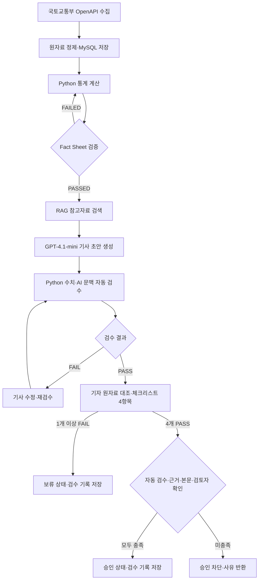
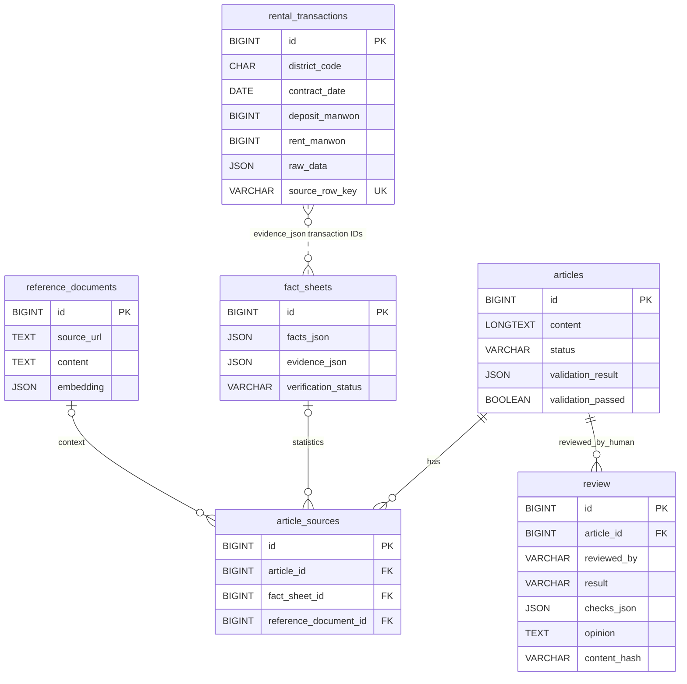

# RentWatch Seoul

> **서울 전월세 실거래 데이터 기반 Fact Sheet·RAG·AI 기사 작성 및 검수 웹 앱**  

> 대상 사용자: 부동산·데이터 저널리즘 취재기자 · 개발 상태: **v0.1 핵심 구현 및 수동 통합 테스트 완료** · 최종 확인: 2026-10-20

## 목차

1. [프로젝트 소개](#1-프로젝트-소개)

2. [구현 기능](#2-구현-기능)

3. [화면 구성](#3-화면-구성)

4. [데이터와 DB](#4-데이터와-db)

5. [데이터 수집·분석·RAG 방식](#5-데이터-수집분석rag-방식)

6. [개발 환경](#6-개발-환경)

7. [로컬 실행 방법](#7-로컬-실행-방법)

8. [검증 결과와 알려진 한계](#8-검증-결과와-알려진-한계)

9. [확장 백로그](#9-확장-백로그)

10. [이용 조건](#10-이용-조건)

## 1. 프로젝트 소개

**RentWatch Seoul**은 공개 전월세 실거래 정보를 수집·분석하고, 검증된 수치를 AI 기사 작성의 근거로 제공하는 취재 지원 서비스다. 국토교통부 자료를 MySQL에 보관하고 Python으로 통계를 계산해 **Fact Sheet**를 만든다. 관련 참고자료를 **RAG**로 검색하여 GPT-4.1-mini에 제공하고, 기사가 생성된 뒤에는 자동 검수와 기자의 수동 검토·승인 과정을 거친다.

**v0.1 적용 범위**

- 지역: 서울 **관악구** (`11620`)

- 주택 유형: **오피스텔**

- 계약월: **2025년 10월~2026년 9월** (12개월)

- 구분: 월세액 0원인 거래는 전세, 월세액이 0원보다 큰 거래는 월세

- 사용자: 로컬 환경에서 사용하는 단일 기자(로그인·다중 권한 관리 없음)

- 결과물: 실거래 통계 화면, Fact Sheet, 근거가 연결된 AI 기사 초안, 자동 검수 및 사람 승인·보류 화면

**검증된 분석 결과 (Fact Sheet #1, 수집 당시 스냅샷)**

| 항목 | 값 |
|---|---:|
| 전체 오피스텔 전월세 거래 | 4,223건 |
| 전세 | 409건 |
| 월세 | 3,814건 |
| 월세 비중(거래 건수 기준) | 90.31% |
| 분석 기간 | 2025-10~2026-09 |
| Fact Sheet 검증 상태 | `PASSED` |

이 수치는 **수집 당시 확보된 신고 자료를 대상으로 한 결과**다. 신고 지연·정정에 따라 이후 수집 결과와 차이가 날 수 있다. 전체 임대주택 재고나 임차인 전체의 주거 부담을 의미하지 않는다.

### 취재 워크플로


> **주의:** `PASS`는 정의된 자동 검사를 통과했다는 뜻이지, 기사 전체의 사실관계가 검증됐다는 뜻이 아니다. 현 버전의 AI 문맥 검수에는 오탐·미탐 사례가 확인돼 있으며 장기 개선 과제로 분리했다. 사람의 검토 없이 자동 발행하지 않는다.

## 2. 구현 기능

| 구분 | 구현 내용 | 현재 상태 |
|---|---|---|
| 데이터 수집 | 국토교통부 오피스텔 전월세 OpenAPI, 월별 수집·MySQL 저장 | 구현·실행 확인 |
| 거래 CRUD API | 개별 거래 등록·목록/상세 조회·수정·삭제, 입력·DB 오류 처리 | Swagger 수동 테스트 통과 |
| 통계 분석 | 전세·월세 분리, 월별 건수·중위값·증감률 계산 | 구현·실행 확인 |
| Fact Sheet | 통계 수치, 원천 거래 ID, 계산식, 검증 항목 저장 | 구현·검증 확인 |
| RAG | 참고문서 등록·임베딩·유사도 검색, 출처 저장 | 구현·실행 확인 |
| AI 기사 생성 | Fact Sheet #1 + 검색된 RAG 문서로 초안 작성 | 구현·실행 확인 |
| 기사 편집 | 웹에서 제목·본문 수정, 기존 검수 결과 무효화 | 구현·실행 확인 |
| 자동 검수 | Python 수치 검사 + LLM 문맥·근거 검사 | 실행 가능, **품질 한계 존재** |
| 기자 체크리스트·승인·보류 | 수치·단위·원인·출처 4항목 판단 기록, Fact Sheet 대조, 승인 조건 서버 검사 | S04 통합·승인 성공 및 차단 경로 수동 확인 |
| 근거 추적 | 기사에 연결된 Fact Sheet·RAG 문서 열람 | 구현·실행 확인 |

**범위 구분:** 서버는 거래 데이터 CRUD API와 기사 조회·편집·생성·검수·승인·보류 기능을 제공한다. 거래 CRUD는 Swagger(`/docs`)에서 실행할 수 있지만, **S01 웹 화면에는 거래 등록·수정·삭제 버튼이나 데이터 재수집 기능이 없다.** S02도 기존 Fact Sheet를 읽는 화면이며, 새 Fact Sheet 생성은 Python 스크립트에서 수행한다. v0.1의 분석 지역·기간·주택 유형은 고정돼 있다.

## 3. 화면 구성

| 화면 | 경로 | 현재 제공 기능 |
|---|---|---|
| **S01 데이터 분석** | `/dashboard` | 관악구 오피스텔 전체·전세·월세 건수, 비중, 12개월 그래프·표 |
| **S02 Fact Sheet** | `/fact-sheet` | 취재 질문·월별 수치·검증 5항목·출처·거래 ID 20개 미리보기 |
| **S03 AI 기사 작성** | `/article-editor` | 기사 선택·조회·편집·저장, AI 초안 생성, 승인·보류 기사 읽기 전용 |
| **S04 검수·승인** | `/review` | 기사 본문·Fact Sheet 나란히 비교, 자동 검수 오류·RAG 근거, 기자 체크리스트 4항목·검토 의견·이력, 승인·보류 |

각 화면 상단 메뉴에서 S01~S04로 이동할 수 있다. S04에서 검수 실패한 기사는 S03에서 수정하고 다시 검수해야 한다. **기사 #4 등 검수 실패 사례를 임의로 PASS로 변경하지 않는다.** 기자 검수는 `/review` 화면에 통합되어 있으며, 별도 `/review-checklist` 페이지는 호환용으로 저장소에 남아 있지만 주 사용 화면은 아니다.

### 화면 캡처

로컬 실행 화면 캡처를 포트폴리오 정리 시 추가할 예정. 현재 저장소에는 확정된 화면 이미지 파일이 포함돼 있지 않다.

## 4. 데이터와 DB

MySQL 데이터베이스 이름은 `rentwatch_seoul`이며, 스키마 정의는 [`db/schema.sql`](db/schema.sql)에 있다. **기본 5개 테이블에 기자 검수 기록용 `review` 테이블을 추가해 총 6개 테이블**을 사용한다. 기존 DB는 [`db/review_migration.sql`](db/review_migration.sql)을 한 번 실행하여 검수 테이블을 추가한다.

| 테이블 | 주요 필드 | 역할 |
|---|---|---|
| `rental_transactions` | `id`, `district_code`, `property_type`, `contract_date`, `area_sqm`, `deposit_manwon`, `rent_manwon`, `raw_data`, `source_row_key`, `collected_at` | 개별 거래와 원본 항목 보관 |
| `fact_sheets` | `id`, `topic`, `region_code`, `property_type`, `period_start`, `period_end`, `facts_json`, `evidence_json`, `verification_status` | 계산값·거래 ID 근거·검증 상태 |
| `reference_documents` | `id`, `title`, `source_org`, `source_url`, `chunk_index`, `content`, `embedding` | RAG 문서 구간과 출처 |
| `articles` | `id`, `title`, `content`, `status`, `validation_result`, `validation_passed`, `reviewed_by`, `reviewed_at`, `updated_at` | 기사 본문·검수·검토 기록 |
| `article_sources` | `article_id`, `fact_sheet_id`, `reference_document_id`, `evidence_role` | 기사와 통계·맥락 근거 연결 |
| `review` | `article_id`, `reviewed_by`, `result`, `checks_json`, `opinion`, `content_hash`, `reviewed_at` | 기자 체크리스트 4항목·검토 의견·시각과 기사 버전 기록 |

`article_sources`는 `STATISTIC`이면 Fact Sheet, `CONTEXT`이면 RAG 문서를 참조한다. 기사와 Fact Sheet는 FK로, Fact Sheet와 원천 거래는 `evidence_json.transaction_ids`의 거래 ID 목록으로 논리적으로 연결한다. 연결된 근거는 삭제 제약을 두어 보존한다.


**데이터 중복·정정 주의:** API에 공개된 고유 거래 ID가 없어, 같은 계약일·금액·면적을 가진 행이 실제로 별개의 거래일 수 있다. 수집 프로그램은 조건이 같은 행도 별도 행으로 보존하며, 이미 수집된 계약월을 재실행할 때는 덮어쓰지 않는다. 이는 **프로젝트 자체의 처리 방식**이지 국토교통부의 공식 중복 판정 규칙이 아니다. 추후 정정 거래 식별·재수집 정책은 개선 여지가 있다.

## 5. 데이터 수집·분석·RAG 방식

### 공공 데이터

- 원천: [국토교통부 오피스텔 전월세 실거래가 OpenAPI](https://www.data.go.kr/data/15126475/openapi.do)

- 조회 조건: 관악구 코드 `11620`, 계약월 `202510`~`202609`

- 처리: 월별 API 응답 XML 파싱 → 날짜·금액·면적 정규화 → `raw_data`와 함께 MySQL 저장

- 분석 시 `source_row_key LIKE 'SEED-SAMPLE-%'`인 가상 테스트 거래 5건은 제외

- 계약일 기준으로 전세(`rent_manwon = 0`)·월세(`rent_manwon > 0`) 거래를 월별 집계

**Fact Sheet #1 월별 거래 건수**

| 계약월 | 전체 | 전세 | 월세 |
|---|---:|---:|---:|
| 2025-10 | 248 | 27 | 221 |
| 2025-11 | 332 | 29 | 303 |
| 2025-12 | 487 | 45 | 442 |
| 2026-01 | 509 | 52 | 457 |
| 2026-02 | 431 | 39 | 392 |
| 2026-03 | 381 | 46 | 335 |
| 2026-04 | 277 | 26 | 251 |
| 2026-05 | 328 | 29 | 299 |
| 2026-06 | 323 | 41 | 282 |
| 2026-07 | 363 | 32 | 331 |
| 2026-08 | 329 | 27 | 302 |
| 2026-09 | 215 | 16 | 199 |
| **합계** | **4,223** | **409** | **3,814** |

Fact Sheet는 Python 계산값과 별도 DB 월별 집계, 전체·유형별 합계, 원천 거래 ID 고유성, 월별 데이터 존재 여부를 확인한다. **`PASSED`는 위 검증 절차를 통과했다는 뜻**이다.

### RAG 참고자료

초기 RAG 문서에는 국토교통부 API의 자료 제공 방식과 정보 비공개 범위 등에 대한 설명을 등록했다. `rag.py`가 임베딩과 유사도 검색을 수행하며, 검색된 문서 ID·기관·원문 링크가 기사 근거로 기록된다. **현재는 공공정책을 자동으로 크롤링·분석하는 기능이 아니다.** 관련 정책 자료 자동 수집은 후속 백로그로 분리했다.

## 6. 개발 환경

| 구분 | 사용 기술 |
|---|---|
| OS·편집기 | Windows / VS Code |
| 실행 언어 | Python (개발 환경에서 3.14로 실행 확인) |
| 서버 | FastAPI + Uvicorn |
| DB | MySQL / SQLAlchemy 2.x / PyMySQL |
| 데이터 처리 | `requests`, `pandas`, Python 표준 XML 처리 등 |
| LLM | OpenAI `gpt-4.1-mini` (기본 설정) |
| 임베딩 | `text-embedding-3-small` (기본 설정) |
| 화면 | HTML / CSS / JavaScript |
| 코드 관리 | Git / GitHub |

필요 패키지는 [`requirements.txt`](requirements.txt)에 명시되어 있다. 정확한 재현을 위한 버전 잠금 파일과 자동 배포 환경은 아직 제공하지 않는다.

`.env.example`을 복사해 로컬 `.env`를 만들고 본인 환경의 값을 입력한다.

| 환경변수 | 용도 |
|---|---|
| `MOLIT_API_KEY` | 국토교통부 API 인증키 |
| `OPENAI_API_KEY` | OpenAI API 키 |
| `OPENAI_MODEL` | 기사 생성·검수 모델(기본 `gpt-4.1-mini`) |
| `OPENAI_EMBEDDING_MODEL` | 임베딩 모델(기본 `text-embedding-3-small`) |
| `DATABASE_URL` | MySQL 접속 문자열 |
| `APP_ENV` | 개발 환경 구분 |

**보안:** 실제 키와 DB 비밀번호가 포함된 `.env`는 Git에 커밋하지 않는다. 이 프로젝트의 웹 승인 API는 로컬 단일 사용자용이며 `reviewed_by` 이름 입력이 실제 신원 인증을 의미하지 않는다. 외부에 서버를 공개 운영하려면 인증·권한·보안 보강이 필요하다.

## 7. 로컬 실행 방법

### 7.1 설치 및 DB 준비

```powershell
python -m pip install -r requirements.txt

Copy-Item .env.example .env
```
`.env`에 필요한 API 키와 MySQL 접속 문자열을 입력한다. MySQL 서버를 켜고 `db/schema.sql`을 **MySQL Workbench**에서 실행하면 데이터베이스 및 테이블을 생성할 수 있다. `db/seed.sql`은 선택적인 **가상 거래 5건**을 입력하므로 실제 분석 데이터와 혼동하지 않는다. 이미 운영 중인 로컬 DB에는 초기화 스크립트를 무심코 재실행하지 않는다.

### 7.2 자료 수집·분석 (초기 DB를 준비할 때)

저장소 루트에서 다음 스크립트를 실행한다.

```powershell
python collect_transactions.py

python analyze_transactions.py

python create_fact_sheet.py
```
수집 대상은 현재 스크립트에 고정된 지역·계약월 기준이다. `create_fact_sheet.py`를 재실행하면 새 Fact Sheet가 생성될 수 있으므로 기존 기사에서 참조하는 **Fact Sheet #1을 임의 교체하거나 삭제하지 않는다.**

RAG 등록·검색 명령은 다음과 같다. 임베딩 생성과 의미 검색에는 OpenAI API 비용이 발생한다. 참고문서가 등록되지 않으면 AI 기사 생성이 진행되지 않는다.

```powershell
python rag.py ingest

python rag.py search "오피스텔 전월세 자료의 공개 기준"
```
### 7.3 웹 서버 실행

```powershell
python -m uvicorn app:app --reload
```
실행 후 브라우저에서 아래 URL을 연다. **배포된 공개 서비스 주소가 아니라 현재 컴퓨터의 로컬 서버**다.

- S01 데이터 분석: http://127.0.0.1:8000/dashboard

- S02 Fact Sheet: http://127.0.0.1:8000/fact-sheet

- S03 AI 기사 작성: http://127.0.0.1:8000/article-editor

- S04 검수·승인: http://127.0.0.1:8000/review

- FastAPI 개발용 API 문서: http://127.0.0.1:8000/docs

### 7.4 웹에서 기사 작업하기

1. **S01**에서 수집된 거래 통계를 확인한다.

2. **S02**에서 Fact Sheet #1의 수치·검증 상태·출처를 확인한다.

3. **S03**에서 **AI 기사 초안 생성**을 누르면 RAG 검색과 OpenAI API 호출이 실행되고 새 기사가 `검토대기`로 저장된다. API 비용이 발생한다.

4. **S03**에서 제목·본문을 수정하면 저장된 자동 검수 결과가 무효화된다. `승인`·`보류` 기사는 현재 편집기에서 읽기 전용이다.

5. **S04**에서 기사와 연결된 Fact Sheet·RAG 원문을 확인하고 자동 검수를 실행한다. AI 검수에도 API 비용이 발생한다.

6. 같은 **S04 화면**에서 기사 본문과 Fact Sheet를 나란히 대조하고, 기자 체크리스트 4개(수치 일치 / 단위·시각·지역 / 원인·전망·과장 / 출처·관측 시각)를 판단한다. 검토자 이름과 의견을 입력하고 **검수 결과 저장**을 누르면 `review` 테이블에 검토 이력이 남는다.

7. 하나라도 실패하면 기사는 즉시 `보류`로 바뀐다. 4개 모두 PASS이고 **자동 검수 PASS·Fact Sheet PASSED·검수 당시 기사 내용·검토자 일치** 조건까지 충족하면 사람이 **기사 승인**을 누를 수 있다. API를 직접 호출하더라도 조건 미충족 시 HTTP `400`과 사유를 반환한다. 사람 검수 PASS 자체가 수치의 자동 재검증을 의미하지는 않는다.

개발용 터미널 워크플로도 존재한다: `generate_article.py`, `validate_article.py <기사ID>`, `edit_article.py export <기사ID>` / `edit_article.py save <기사ID>`.

### 7.5 Swagger에서 전월세 거래 CRUD 시험하기

`python -m uvicorn app:app --reload`로 서버를 시작한 뒤 [Swagger UI](http://127.0.0.1:8000/docs)에서 `전월세 거래 CRUD` API를 펼치고 **Try it out → Execute**로 요청한다. DB 연결과 거래 저장은 MySQL에서 처리하므로 서버를 재시작해도 저장 내용이 유지된다.

| 메서드 | 경로 | 기능 | 성공 응답 |
|---|---|---|---|
| `POST` | `/api/transactions` | 거래 등록 | `201 Created` |
| `GET` | `/api/transactions` | 거래 목록 조회 (`limit`, `offset`) | `200 OK` |
| `GET` | `/api/transactions/{transaction_id}` | 거래 1건 조회 | `200 OK` |
| `PUT` | `/api/transactions/{transaction_id}` | 거래 1건 수정 | `200 OK` |
| `DELETE` | `/api/transactions/{transaction_id}` | 거래 1건 삭제 | `204 No Content` |

**오류 처리:** 없는 거래 ID는 `404`, 필수 필드 누락이나 음수 면적 등 Pydantic 입력 검증 실패는 `422`, 중복 `source_row_key` 등 DB 무결성 오류는 `400`을 반환한다. **Fact Sheet의 거래 ID 근거 목록에 포함된 거래는 수정·삭제를 `409 Conflict`로 차단하도록 구현되어 있으나, 해당 차단 경로의 별도 수동 테스트 결과는 아직 없다.**

Swagger 예시 입력은 실제 거래가 아니므로 테스트용 데이터로만 사용하고 시험 뒤 삭제한다. 원자료를 변경하면 통계와 근거에 영향을 줄 수 있으므로, 이미 기사·Fact Sheet에 쓰인 실거래 데이터는 직접 수정하지 않는다.

## 8. 검증 결과와 알려진 한계

### 수동 통합 테스트 (2026-10-20)

| 검증 내용 | 확인 결과 |
|---|---|
| S01 월별 거래 통계 및 전체 건수 대조 | 4,223건·전세 409건·월세 3,814건 일치 |
| S02 Fact Sheet 표시 | #1, `PASSED`, 근거·검증 항목 확인 |
| S03 기사 생성·편집·DB 저장 | 실행 확인 |
| 수정 후 종전 검수 무효화 | 실행 확인 |
| S04 기사별 검수 결과·Fact Sheet·RAG 조회 | 실행 확인 |
| S04 자동 검수 실행 | 실행 확인(PASS 및 FAIL 사례 존재) |
| 검수 실패 기사 승인 차단 | FastAPI API에서 확인 |
| 검수 PASS 기사 승인 | FastAPI API에서 확인, 검토자·시각 DB 기록 |
| 웹 보류 버튼 및 DB 기록 | 실행 확인 |
| S04 기자 체크리스트와 웹 승인 성공 | 기사 #8 자동 검수 PASS·체크리스트 4개 PASS 뒤 **웹 승인 성공** |
| S01~S04 화면 이동 | 실행 확인 |

### 기자 체크리스트·승인 차단 수동 테스트 (2026-10-20)

기사 본문과 연결된 Fact Sheet를 S04에서 비교하며 기자가 직접 체크리스트를 판정한다. 검토 이력은 별도 `review` 테이블에 저장한다. 아래는 사용자 로컬 MySQL·Swagger·웹 화면에서 확인한 결과다.

| 테스트 | 요청·조건 | 기대 결과 | 실제 결과 |
|---|---|---|---|
| 체크리스트 FAIL 저장 | 테스트 기사, 4개 중 1개 미체크 | 검수 `FAIL`, 기사 `보류`, 의견·시각 기록 | **PASS** · 실패 기록·보류 확인 |
| 보류 기사 승인 차단 | `POST /articles/{id}/approve` | `400`, 보류 상태 사유 | **PASS** · `400`, 검토대기만 승인 가능 |
| 체크리스트 미제출 차단 | 검토대기 기사 #1 승인 요청 | `400`, 검수 기록 없음 안내 | **PASS** · `400`, 체크리스트 선행 요청 |
| 체크리스트 PASS 기록 | 4개 체크 및 검토자 입력 | `PASS`, 검토 기록 조회 | **PASS** · 기록과 시각 표시 |
| 검토자 불일치 | 체크리스트와 다른 검토자로 승인 요청 | `400`, 검토자 불일치 안내 | **PASS** · `400` |
| 체크리스트 PASS·자동 검수 미통과 | 테스트 기사 승인 요청 | `400`, 자동 검수 미통과 안내 | **PASS** · `400` |
| 정상 승인 | 기사 #8 자동 검수 PASS·체크리스트 4개 PASS 후 웹에서 승인 | 상태 `승인`, 검토자·시각 기록 | **PASS** · S04 웹 승인 성공 보고 |
| 검수 기록 지속·변경 후 무효성 | 서버 재시작/기사 본문 변경 뒤 조건 재검증 | 기존 기록 보존, 현재 본문 불일치 시 승인 불가 | **미실행** · 코드에 검사 로직 존재 |

**한계:** 체크박스는 기자의 판단을 기록할 뿐 자동으로 네 가지 사실을 보증하지 않는다. 특히 테스트용으로 저장한 `PASS`는 실제 보도용 사실 검증 완료를 뜻하지 않는다. 기존 승인 기사 상태를 소급 변경하지 않는다.

### 거래 CRUD 및 오류 처리 테스트 (2026-10-20)

Swagger에서 테스트용 거래를 등록해 실행한 결과다. 성공 후 생성된 테스트 데이터는 삭제했다.

| 테스트 | 요청 | 기대 결과 | 실제 결과 |
|---|---|---|---|
| 등록(Create) | `POST /api/transactions` 정상 거래 | `201`, 새 거래 ID 반환 | **PASS** · `201`, ID `4229` 생성 |
| 상세 조회(Read) | `GET /api/transactions/4229` | `200`, 등록값 조회 | **PASS** · `200` |
| 수정(Update) | `PUT /api/transactions/4229` | `200`, 수정 내용 반영 | **PASS** · `200` |
| 서버 재시작 후 영속성 | Uvicorn 종료·재실행 후 `GET /api/transactions/4229` | `200`, 수정값 그대로 유지 | **PASS** · MySQL 데이터 유지 확인 |
| 삭제(Delete) | `DELETE /api/transactions/4229` | `204`, 본문 없음 | **PASS** · `204` |
| 삭제한 ID 조회 | `GET /api/transactions/4229` | `404`, 거래 없음 안내 | **PASS** · `404` |
| 필수값 누락 | `POST /api/transactions`에 `district_name`만 전달 | `422`, 누락 필드 안내 | **PASS** · `422` |
| 입력값 위반 | `POST /api/transactions`, `area_sqm=-10` | `422`, 면적은 0 초과여야 함 | **PASS** · `422`, `greater_than` |
| DB UNIQUE 제약 위반 | 동일 `source_row_key`로 `POST` 두 번 | 첫 요청 `201`, 두 번째 `400` | **PASS** · `201` → `400` |
| 테스트 거래 정리 | 중복 키 시험 거래 삭제 후 SQL 건수 조회 | 잔여 건수 `0` | **PASS** · `0` |
| Fact Sheet 근거 거래 변경 차단 | 근거에 포함된 거래를 `PUT`/`DELETE` | `409`, 근거 보호 안내 | **미실행** · 코드상 보호 로직 존재 |

**주의:** 음수 면적은 DB 제약조건까지 도달하기 전에 API 입력 검증에서 `422`로 차단된다. 실제 `400`은 중복 식별키로 확인했다. 위 테스트는 개발자의 로컬 MySQL·Swagger 수동 실행 결과이며 자동화된 테스트 스위트나 공개 배포 검증을 의미하지 않는다.

**로컬 테스트 기사 예시 (사용자의 실행 DB 기준)**

- #1: `검토대기`, 본문 수정으로 기존 검수 결과 무효화

- #2: `보류`, 검토자·시각 기록

- #3: `승인`, 자동 검수 PASS, 검토자·시각 기록

- #4: `검토대기`, 자동 검수 FAIL (오탐 사례)

- #5: `보류`, S04 웹에서 처리

- #8: `승인`, 자동 검수 PASS와 기자 체크리스트 PASS 후 S04 웹에서 최종 승인

테스트 기사 ID와 DB 상태는 **개발자 로컬 MySQL의 결과**로, Git 저장소를 클론하면 자동으로 재현되는 샘플 데이터가 아니다.

### 알려진 한계

1. **AI 검수 품질:** 올바른 수치를 오류로 판단하거나, 실제 없는 출처 혼동을 지적하는 오탐과, 부정확한 추세·법률 설명을 놓치는 미탐이 확인됐다. 현재 `PASS`와 `FAIL`은 검수 엔진의 판정이며 사람의 사실 확인을 대체하지 않는다.

2. **Python 수치 검사 범위:** 현재 정규식은 일부 표현 형식만 인식한다. 검사가 포착하지 못한 숫자 문장을 정확하다고 보장하지 않는다.

3. **검수 승인 운영:** 자동 검수 FAIL을 사람이 검토해도 현 시스템은 예외 승인을 지원하지 않는다. 체크리스트 4개 PASS 역시 자동 검수 PASS를 대체하지 않으며, 잘못된 FAIL을 임의로 PASS로 변경해 승인하지 않는다.

4. **자료 시차·중복·정정:** 데이터는 수집 시점의 스냅샷이다. API가 공개 고유 거래 ID를 제공하지 않으며 신고 지연·정정, 동일 조건 거래의 식별에 한계가 있다.

5. **고정 분석 범위:** v0.1의 지역·유형·기간 및 기사 생성에 사용되는 Fact Sheet는 코드에서 고정돼 있다. 웹에서 자유롭게 조건을 바꾸거나 새 Fact Sheet를 생성하는 기능은 없다.

6. **보안·배포:** 로그인·권한·공개 배포·자동 발행 기능은 없고, 로컬 개발용 단일 사용자 워크플로를 전제로 한다.

## 9. 확장 백로그

### A. AI 자동 검수 정확도 개선

**장기 품질 개선 과제.** Python이 검증 가능한 수치와 LLM이 검토할 문맥·근거의 책임을 분리하고, 검수기의 개별 오류 주장을 다시 검증하는 체계를 설계한다. 사람 라벨링 기반 오탐·미탐 평가셋, 회귀 테스트, 오류/검토 필요/개선 제안의 판정 단계 구분 등을 검토한다. 기존의 재검수 강제·승인 차단·사람 최종 판단 규칙은 유지한다.

### B. 부동산 정책자료 자동 수집 및 거래 통계 연계 분석

국토교통부 등 공식기관의 정책·법령 자료를 자동으로 수집하고 적용 대상(지역·주택 유형·시점)을 구조화하여 실거래 통계와 함께 취재 질문을 발굴하는 확장 기능을 검토한다. 정책과 거래량 사이의 인과관계는 단순한 시점 일치만으로 단정하지 않는다. 현재 v0.1의 **수동 등록 RAG와 구분**한다.

### C. 분석·운영 범위 확대

서울 다른 자치구 및 아파트·연립다세대·단독다가구 자료로 확대하고, 필터·재수집·정정 처리·원자료 대조·인증 체계를 보강한다. 각 항목은 추가 데이터 품질 검증 및 별도 설계 후 착수한다.

## 10. 이용 조건

### 소프트웨어 라이선스

프로젝트의 자체 작성 소스코드와 문서는 [MIT License](LICENSE)에 따라 배포한다. 저작권 표시와 라이선스 고지를 유지하는 조건으로 사용·수정·재배포할 수 있다. **외부 공공데이터와 인용 원문에 MIT 라이선스를 재부여하는 것은 아니다.** 각 원천 자료의 이용 조건은 제공기관 안내를 따른다.

### 데이터 출처와 수집 방법

- **제공기관:** 국토교통부 / 공공데이터포털
- **자료명:** [국토교통부 오피스텔 전월세 실거래가 자료(OpenAPI)](https://www.data.go.kr/data/15126475/openapi.do)
- **수집 방법:** `collect_transactions.py`가 API 인증키를 사용해 관악구 법정동 코드 앞 5자리 `11620`, 계약월 `202510`~`202609`의 XML 응답을 월별 조회하고, 계약일·보증금·월세액·면적을 정규화해 MySQL에 저장한다. Python 스크립트로 월별 통계와 Fact Sheet를 산출한다.
- **자료의 성격:** 신고·공개 시점의 실거래 자료 스냅샷이며, 지연 신고·정정으로 수치가 달라질 수 있다. 가상 테스트 거래는 분석에서 제외한다.
- **원천 자료 이용:** 공공데이터포털의 해당 API 이용 조건을 확인해야 한다. 원천 데이터와 서비스 자체의 라이선스는 구별한다.

### AI 생성·지원 사용 여부 (2026-10-27 기준 공개)

- **AI 사용: 있음.** 서비스는 OpenAI API의 `gpt-4.1-mini`(기본 설정)로 기사 **초안 생성과 문맥·근거 자동 검수**를 수행하며, `text-embedding-3-small`(기본 설정)로 RAG 참고문서 임베딩과 검색을 지원한다. 사용 모델은 환경변수로 바꿀 수 있다.
- **사용 도구:** Python, FastAPI, OpenAI API 및 RAG. 통계값과 Fact Sheet는 Python 계산·검증 결과이며, AI가 작성한 기사 초안과 구분된다.
- **시점:** 2026-10-20 수동 통합 테스트 기록에 AI 초안 생성·검수 실행이 확인된다. **개별 AI 기사·문서 문구의 정확한 생성 날짜는 README만으로 확인되지 않으므로 임의로 기재하지 않는다.** 이 이용 조건의 문서화 기준일은 2026-10-27이다.
- **검토 책임:** AI 생성 결과는 기자가 수치·원문·출처를 대조하고 최종 승인해야 한다. 자동 검수 PASS는 사실관계 전체의 검증 완료를 뜻하지 않는다.

### 외부 문구의 인용과 출처

`references/molit_officetel.txt`에는 국토교통부 공공데이터포털의 오피스텔 전월세 OpenAPI **설명 문구를 직접 인용**했다. 원문과 일치 여부를 문장 검색 및 [공식 자료 설명](https://www.data.go.kr/data/15126475/openapi.do)에서 확인했다. 이 문구는 자체 창작 문구가 아니며, 원문 인용임을 파일에 표시하고 출처 URL을 명시한다.

외부 자료의 문장을 그대로 사용할 때는 인용 부호(“ ”)로 구분하고 기관·문서명·원문 URL을 표시한다. AI가 작성한 기사 역시 원문과 동일한 문장을 사용한다면 해당 출처를 확인해 인용 표시한다. **현재 저장소만으로 로컬 DB에 저장된 모든 생성 기사 본문의 중복 문장 검색까지 완료했다고 볼 수는 없다.**

**---**

**프로젝트 성격:** 취재기자가 데이터와 근거를 점검하면서 기사 초안을 만들도록 돕는 **로컬 프로토타입**. 자동 검수 결과만으로 보도하거나 외부에 자동 발행하지 않는다.
